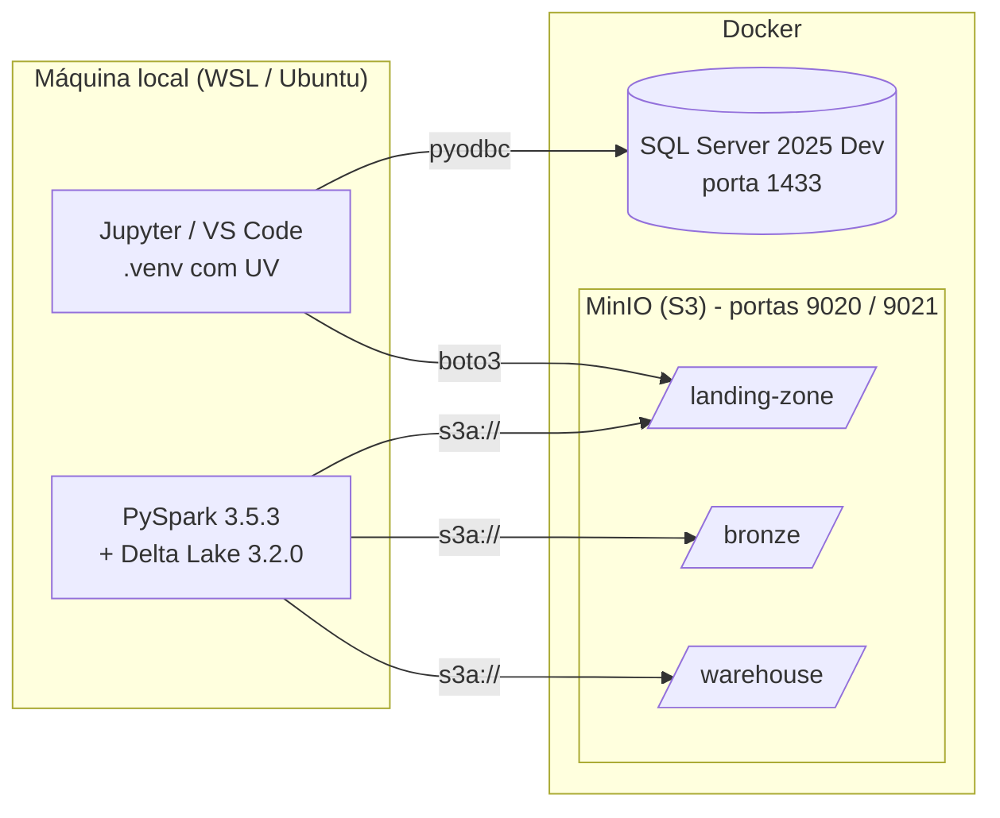

# Arquitetura

## Componentes

| Componente | Papel no projeto |
|---|---|
| **SQL Server 2025 Developer** (Docker) | Banco de origem (OLTP) com o `LojaDB` |
| **MinIO** (Docker) | Object storage compatível com S3: é o data lake |
| **PySpark + Delta Lake** (local) | Motor que lê os CSVs e grava/manipula as tabelas Delta |
| **pyodbc** | Conexão Python → SQL Server (ODBC Driver 18) |
| **boto3** | Cliente S3: cria buckets, grava os CSVs, lista arquivos |
| **Jupyter** | Execução dos notebooks |

## Camadas (arquitetura medalhão)

A arquitetura medalhão organiza o lake em camadas de qualidade crescente. Este trabalho implementa as duas primeiras:

| Bucket | Camada | Formato | Conteúdo |
|---|---|---|---|
| `landing-zone` | Landing | CSV | Cópia fiel das tabelas do banco, 1 arquivo por tabela |
| `bronze` | Bronze | Delta Lake | Mesmos dados, tipados, em formato transacional + coluna técnica `_dt_ingestao` |
| `warehouse` | — | Delta Lake | Diretório das **tabelas gerenciadas** do Spark (usado no notebook 04) |

As próximas camadas (silver com dados limpos e integrados, gold com agregações para consumo) ficariam para trabalhos futuros.

## Notebooks

| # | Notebook | Etapa | Ferramentas |
|---|---|---|---|
| 00 | `00_setup_sqlserver.ipynb` | Cria o `LojaDB` e carrega as 7 tabelas a partir de `data/*.csv` | pandas, pyodbc |
| 01 | `01_sqlserver_to_minio_csv.ipynb` | Extrai todas as tabelas → `landing-zone` | pyodbc, pandas, boto3 |
| 02 | `02_csv_to_delta.ipynb` | `landing-zone` → `bronze` (Delta) | PySpark, Delta |
| 03 | `03_dml_delta.ipynb` | INSERT / UPDATE / DELETE, HISTORY e Time Travel | Spark SQL, API `DeltaTable` |
| 04 | `04_tabelas_gerenciadas_vs_externas.ipynb` | Gerenciada × externa na prática | Spark SQL, boto3 |

## Organização do código

O código repetido entre notebooks (configuração, conexões, SparkSession) fica em um pacote Python em `src/spark_delta/`, instalado no ambiente pelo `uv sync`:

| Módulo | Responsabilidade |
|---|---|
| `config.py` | Lê o `.env` da raiz do projeto e expõe as configurações (`settings`) |
| `sqlserver.py` | `connect()` para o SQL Server |
| `storage.py` | Cliente S3 do MinIO, criação de bucket e listagem de objetos |
| `spark_session.py` | `get_spark()`: SparkSession com Delta + S3A configurados |
| `schemas.py` | Schemas explícitos das tabelas para a leitura dos CSVs |

Assim cada notebook mostra só a lógica da sua etapa, e uma mudança de configuração (por exemplo, a porta do MinIO) é feita em um único lugar: o `.env`.
