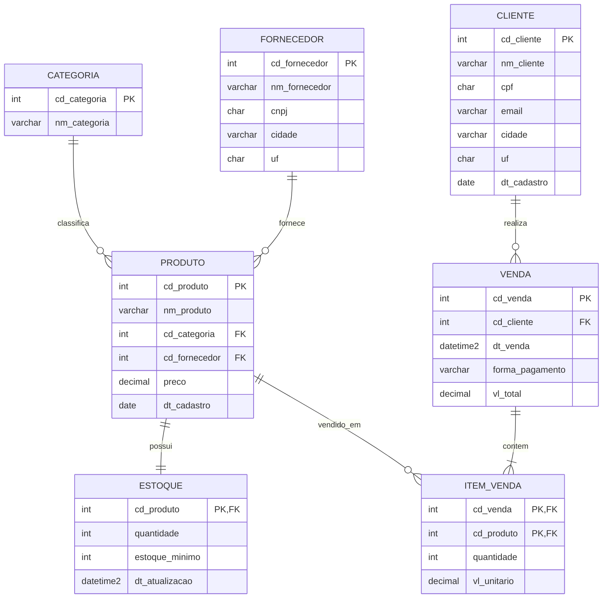

# Cenário e dados

## Cenário: loja de eletrônicos

No Trabalho 1 o grupo modelou o **controle de estoque** de uma loja de eletrônicos em uma única tabela (`estoque_delta` / `estoque_iceberg`), criada e populada à mão dentro do Spark.

No Trabalho 2 o mesmo negócio é representado como ele existiria num sistema real: um banco relacional normalizado, o **LojaDB**, com categorias, fornecedores, produtos, estoque, clientes e vendas. É desse banco que o pipeline extrai os dados.

## Conjunto de dados

Os dados são **sintéticos, criados pelo grupo** com o script [`scripts/gerar_dados.py`](https://github.com/MaicouHahn/spark-delta/blob/main/scripts/gerar_dados.py), que usa apenas a biblioteca padrão do Python. A semente aleatória é fixa (`42`), então o script gera sempre exatamente os mesmos arquivos em `data/`.

| Tabela | Registros | Descrição |
|---|---:|---|
| `categoria` | 8 | Computadores, Periféricos, Monitores, Smartphones, Áudio, Armazenamento, Redes, Games |
| `fornecedor` | 25 | Distribuidores, com CNPJ e cidade |
| `produto` | 120 | Catálogo (nome, categoria, fornecedor, preço, data de cadastro) |
| `estoque` | 120 | Quantidade disponível e estoque mínimo de cada produto |
| `cliente` | 1.000 | Clientes com CPF, e-mail e cidade |
| `venda` | 5.000 | Vendas de 2024 a set/2026, forma de pagamento e valor total |
| `item_venda` | 10.964 | Produtos de cada venda (o `vl_total` da venda é a soma dos itens) |

Para regenerar os CSVs:

```bash
uv run python scripts/gerar_dados.py
```

## Modelo ER



## DDL no SQL Server

Executado pelo notebook `00_setup_sqlserver.ipynb`, na ordem das dependências:

```sql
CREATE TABLE categoria (
    cd_categoria  INT          NOT NULL PRIMARY KEY,
    nm_categoria  VARCHAR(50)  NOT NULL
);

CREATE TABLE fornecedor (
    cd_fornecedor INT          NOT NULL PRIMARY KEY,
    nm_fornecedor VARCHAR(100) NOT NULL,
    cnpj          CHAR(14)     NOT NULL,
    cidade        VARCHAR(60)  NOT NULL,
    uf            CHAR(2)      NOT NULL
);

CREATE TABLE produto (
    cd_produto    INT           NOT NULL PRIMARY KEY,
    nm_produto    VARCHAR(100)  NOT NULL,
    cd_categoria  INT           NOT NULL REFERENCES categoria (cd_categoria),
    cd_fornecedor INT           NOT NULL REFERENCES fornecedor (cd_fornecedor),
    preco         DECIMAL(12,2) NOT NULL,
    dt_cadastro   DATE          NOT NULL
);

CREATE TABLE estoque (
    cd_produto     INT          NOT NULL PRIMARY KEY REFERENCES produto (cd_produto),
    quantidade     INT          NOT NULL,
    estoque_minimo INT          NOT NULL,
    dt_atualizacao DATETIME2(0) NOT NULL
);

CREATE TABLE cliente (
    cd_cliente  INT          NOT NULL PRIMARY KEY,
    nm_cliente  VARCHAR(100) NOT NULL,
    cpf         CHAR(11)     NOT NULL,
    email       VARCHAR(100) NOT NULL,
    cidade      VARCHAR(60)  NOT NULL,
    uf          CHAR(2)      NOT NULL,
    dt_cadastro DATE         NOT NULL
);

CREATE TABLE venda (
    cd_venda        INT           NOT NULL PRIMARY KEY,
    cd_cliente      INT           NOT NULL REFERENCES cliente (cd_cliente),
    dt_venda        DATETIME2(0)  NOT NULL,
    forma_pagamento VARCHAR(20)   NOT NULL,
    vl_total        DECIMAL(14,2) NOT NULL
);

CREATE TABLE item_venda (
    cd_venda    INT           NOT NULL REFERENCES venda (cd_venda),
    cd_produto  INT           NOT NULL REFERENCES produto (cd_produto),
    quantidade  INT           NOT NULL,
    vl_unitario DECIMAL(12,2) NOT NULL,
    PRIMARY KEY (cd_venda, cd_produto)
);
```

!!! note "Por que os CSVs são lidos como texto na carga"
    No notebook 00, `pd.read_csv(..., dtype=str)` mantém CPF e CNPJ como texto (sem perder zeros à esquerda). O SQL Server converte os demais valores para `INT`, `DECIMAL`, `DATE` e `DATETIME2` na inserção, de acordo com o DDL.
