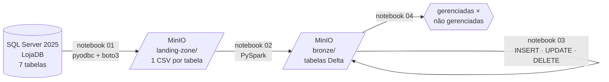

# Trabalho 2 — Apache Spark com MinIO e SQL Server

Documentação do **Trabalho 2** da disciplina de Engenharia de Dados (SATC): um pipeline que extrai os dados de um banco relacional, grava no **MinIO** como CSV (camada *landing-zone*) e converte para **Delta Lake** (camada *bronze*), onde são executadas operações DML com o **Apache Spark**.

!!! info "Este site × README"
    O [README do repositório](https://github.com/MaicouHahn/spark-delta#readme) é o **passo a passo para reproduzir o ambiente** (instalação, versões, comandos).
    Este site **explica** o trabalho: o cenário, as tecnologias, cada etapa do pipeline e os resultados.

## Integrantes

| Nome | GitHub |
|---|---|
| Maicou Hahn Fortuna | [@MaicouHahn](https://github.com/MaicouHahn) |
| Guilherme Victor Machado | [@gvm7b](https://github.com/gvm7b) |
| Evandro Luiz Rodrigues Damazio | — |

## Objetivo

O Trabalho 2 complementa o [Trabalho 1](https://github.com/MaicouHahn/Pyspark-Jupyter). No Trabalho 1, o cenário de **Controle de Estoque** de uma loja de eletrônicos foi criado direto dentro do Spark, em tabelas locais Delta e Iceberg. Neste trabalho, o mesmo negócio passa a ter uma **origem real** (um banco SQL Server) e os dados percorrem um pipeline até um data lake:

1. **Extração** de todas as tabelas do banco `LojaDB` (SQL Server 2025) para o bucket `landing-zone` no MinIO, um CSV por tabela.
2. **Conversão** dos CSVs para tabelas **Delta Lake** no bucket `bronze`.
3. **DML**: as mesmas operações `INSERT`, `UPDATE` e `DELETE` do Trabalho 1, agora sobre as tabelas Delta da bronze, com `HISTORY` e *Time Travel*.
4. **Análise** das diferenças entre tabelas **gerenciadas** e **não gerenciadas** nos dois laboratórios.

## Como navegar

| Página | Conteúdo |
|---|---|
| [Arquitetura](arquitetura.md) | Componentes, camadas e o que cada notebook faz |
| [Cenário e dados](dados.md) | Modelo ER, DDL e como o conjunto de dados foi gerado |
| [Apache Spark](apache-spark.md) · [Delta Lake](delta-lake.md) · [MinIO](minio.md) | As tecnologias usadas |
| [Pipeline](extracao.md) | Cada etapa explicada com o código |
| [Gerenciadas × não gerenciadas](tabelas-gerenciadas.md) | Item 4 do trabalho: comparação entre os laboratórios |
